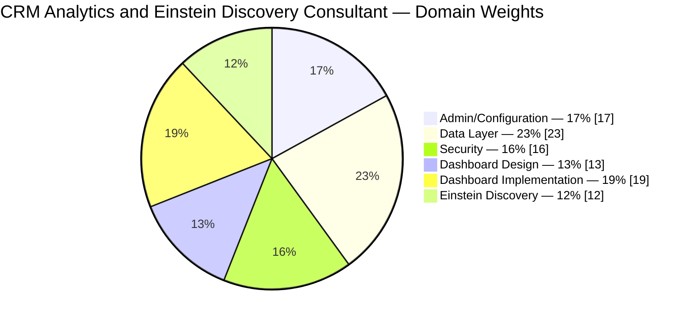
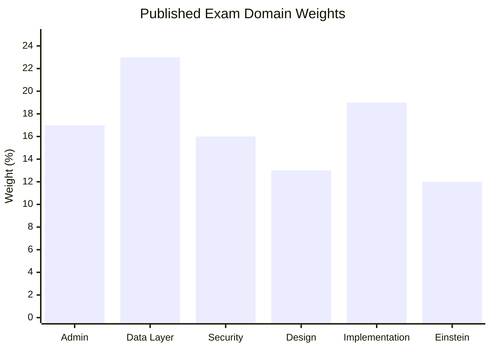
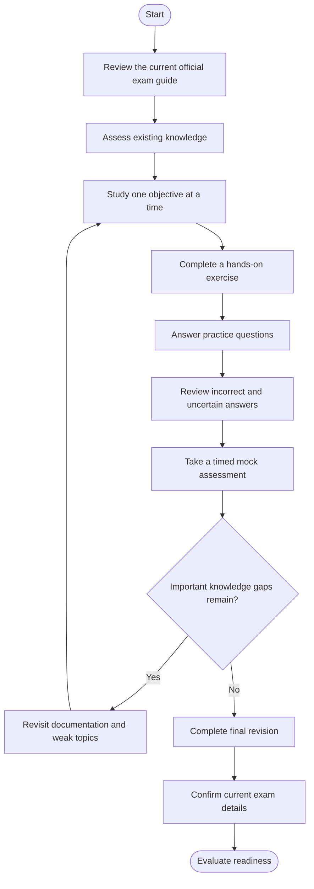
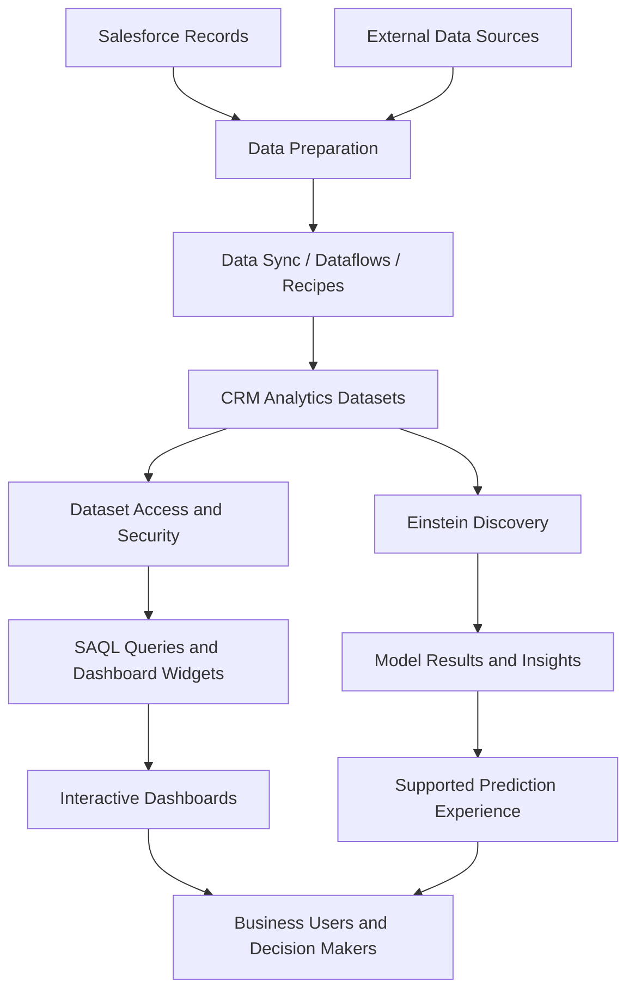
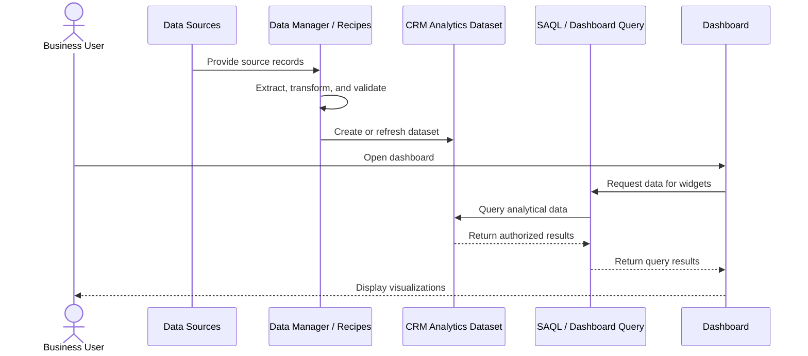
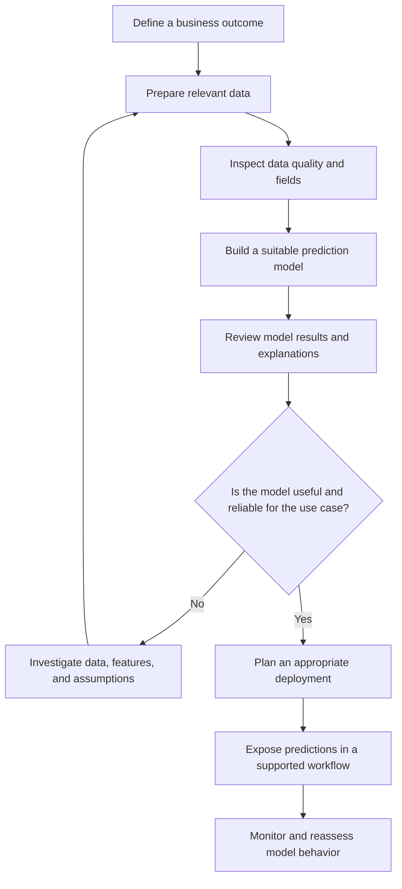
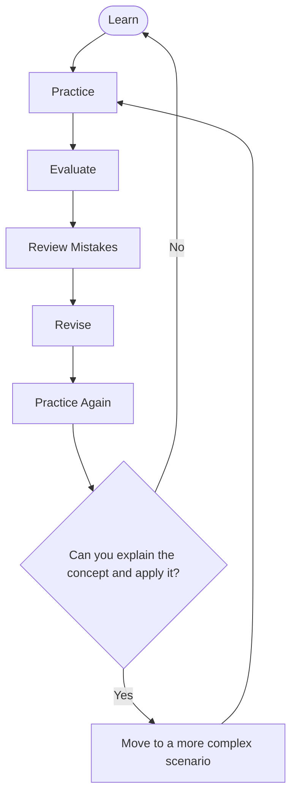
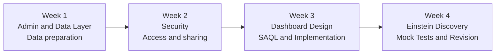

# Salesforce CRM Analytics and Einstein Discovery Consultant — Study Guide

A practical study resource for learning how to prepare, analyze, visualize, secure, and interpret data with Salesforce CRM Analytics and Einstein Discovery.

This repository brings together exam-objective summaries, technical diagrams, hands-on project ideas, original practice questions, and official Salesforce learning resources. It is designed for learners who want to understand the technology and apply it to realistic business requirements rather than rely on memorized answers.

> **Exam information notice:** The official Salesforce exam guide referenced here aligns to the Spring ’24 release. Exam policies and objectives can change. Confirm the current requirements with Salesforce before registering.

For supplementary preparation materials, visit the [CertsGate Salesforce exam catalog](https://certsgate.com/exams/salesforce).

---

## Table of Contents

- [Overview](#overview)
- [About the Certification](#about-the-certification)
- [Who Should Prepare?](#who-should-prepare)
- [Core Technical Skills](#core-technical-skills)
- [Official Exam Objectives](#official-exam-objectives)
- [Exam Domain Weightage](#exam-domain-weightage)
- [Certification Preparation Flowchart](#certification-preparation-flowchart)
- [CRM Analytics Architecture](#crm-analytics-architecture)
- [Data Preparation and Dashboard Sequence](#data-preparation-and-dashboard-sequence)
- [Einstein Discovery Workflow](#einstein-discovery-workflow)
- [Circular Study and Revision Cycle](#circular-study-and-revision-cycle)
- [Step-by-Step Preparation Guide](#step-by-step-preparation-guide)
- [Four-Week Study Roadmap](#four-week-study-roadmap)
- [Hands-On Projects](#hands-on-projects)
- [Original Practice Questions](#original-practice-questions)
- [Reviewing Mistakes and Assessing Readiness](#reviewing-mistakes-and-assessing-readiness)
- [Common Preparation Mistakes](#common-preparation-mistakes)
- [Career Relevance](#career-relevance)
- [Frequently Asked Questions](#frequently-asked-questions)
- [Official and Additional Resources](#official-and-additional-resources)
- [About CertsGate](#about-certsgate)
  
---

## Overview

Salesforce CRM Analytics helps organizations turn business data into dashboards, interactive explorations, and actionable insights. Einstein Discovery adds capabilities for analyzing patterns in data, building predictive models, and understanding factors associated with a business outcome.

A consultant working with these tools needs to understand more than chart creation. Data must be prepared correctly, access must be designed carefully, dashboards must answer business questions, and analytical results must be interpreted responsibly.

This study guide focuses on six connected areas:

- Administering and configuring CRM Analytics.
- Preparing data through synchronization, dataflows, recipes, and datasets.
- Applying security and access controls.
- Designing dashboards around business requirements.
- Implementing interactive and performant analytics experiences.
- Building and evaluating Einstein Discovery models.

The aim is to connect the certification objectives with practical implementation decisions.

## About the Certification

The **Salesforce Certified CRM Analytics and Einstein Discovery Consultant** credential evaluates knowledge and skills related to designing and implementing CRM Analytics and Einstein Discovery solutions.

Salesforce describes the target audience as professionals who work in customer-facing consulting or internal architecture roles. The official preparation material also highlights data management, analytics and business intelligence, systems architecture, and cybersecurity. See the [official Salesforce credential page](https://trailhead.salesforce.com/en/credentials/crmanalyticsandeinsteindiscoveryconsultant).

### Exam information

The published Salesforce exam guide contains the following details for the version aligned to Spring ’24.

| Detail | Published guide information |
|---|---|
| Credential | Salesforce Certified CRM Analytics and Einstein Discovery Consultant |
| Provider | Salesforce |
| Question format | Multiple-choice questions |
| Question count | 60 scored questions, with up to 5 additional unscored questions |
| Time limit | 90 minutes |
| Passing score | 65% |
| Delivery | Proctored, onsite or online |
| Reference materials | Not permitted during the exam |
| Prerequisite | None listed in the guide |
| Guide version | Spring ’24 |

These details are taken from Salesforce's published guide and should be verified before an exam attempt. Registration availability, policies, and exam content can change.

Official reference: [CRM Analytics and Einstein Discovery Consultant Exam Guide](https://help.salesforce.com/s/articleView?id=005298935&language=en_US&type=1).

## Who Should Prepare?

This certification may suit professionals who already have experience with Salesforce and business analytics, including:

- Salesforce consultants designing analytics solutions.
- Administrators configuring CRM Analytics access and settings.
- Business intelligence professionals building dashboards and datasets.
- Data professionals familiar with extraction, transformation, and loading.
- Technical architects planning data and analytics solutions.
- Salesforce developers or analysts who work with SAQL and SOQL.

Useful background includes data modeling, ETL processes, dashboard design, basic statistical reasoning, and the Salesforce platform. Familiarity with SQL-like query languages and data security concepts is especially helpful.

If you are new to the product, start with the official Trailhead learning path and use a suitable training environment to reinforce the concepts.

---

## Core Technical Skills

### 1. CRM Analytics administration

Learn how CRM Analytics is enabled and configured, how licenses and permission sets affect access, and how analytics assets are deployed between environments.

Topics to understand include:

- Permission sets and licenses.
- App and dataset access.
- Deployment and metadata migration.
- Extended metadata (XMD).
- Platform capabilities and API use cases.
- Data processing and refresh constraints.

### 2. Data preparation and management

Reliable analytics starts with reliable data.

Understand how Salesforce and external data sources become datasets, how data synchronization works, and when dataflows or recipes are appropriate.

Focus on:

- Data Manager.
- Data sync.
- Dataflows and recipes.
- Dataset creation and refresh scheduling.
- Derived fields and data transformations.
- Data quality and data preparation.
- Platform processing limits and performance considerations.

**Example:** A sales dashboard combines opportunities with quota information. Before creating visualizations, establish how the source data is extracted, joined, transformed, refreshed, and validated.

### 3. Security

Analytics security must reflect the business requirements for data access.

Study how permissions control access to apps and datasets, and how row-level security can limit which records a user sees.

Important concepts include:

- Users, groups, and permission sets.
- App and dataset sharing.
- Security inheritance.
- Security predicates.
- Row-level access requirements.
- Testing access from different user perspectives.

**Example:** A regional sales manager should see records for their permitted territory, while an executive may need access to a broader set of results. The solution must reflect those requirements without exposing unauthorized rows.

### 4. Dashboard design

Good dashboards help users answer specific business questions.

Learn to translate requirements into meaningful visualizations and interactions. A chart should support a decision, not merely display available data.

Study:

- Dashboard layout and user experience.
- Appropriate visualization selection.
- Filters and interactions.
- Dashboard pages and widgets.
- Mobile and desktop presentation.
- Standard analytics applications and templates.
- Clear labels, useful comparisons, and accessible design.

### 5. Dashboard implementation

Dashboard implementation connects the design to queries, data, and user interactions.

Review:

- SAQL and query selection.
- Widget-level query parameters.
- Selection and result interactions.
- Compare tables, windowing, and time-series analysis.
- Embedding analytics in Salesforce pages.
- Dashboard Inspector and performance troubleshooting.
- Versioning and publishing approaches.

### 6. Einstein Discovery

Einstein Discovery supports predictive analysis and model-based insights.

Learn how to assess data, select an appropriate prediction type, interpret model results, and identify changes that may improve model quality.

Key areas include:

- Binary classification.
- Multiclass classification.
- Numeric prediction.
- Data preparation and feature selection.
- Model results and explanations.
- Model Cards and model evaluation.
- Prediction deployment and supported write-back workflows.
- Monitoring model behavior and communicating limitations.

A useful consultant does not treat a model result as automatically correct. The result must be interpreted in context and evaluated against the business problem.

---

## Official Exam Objectives

The Salesforce exam guide organizes the exam into six domains. The table below summarizes their subject areas; consult the official guide for the detailed objective wording.

| Domain | Main study areas |
|---|---|
| Admin/Configuration | Enablement, licenses, permissions, platform limits, APIs, environment migration |
| Data Layer | Data Manager, source extraction, synchronization, dataflows, recipes, dataset refreshes |
| Security | App and dataset sharing, users and groups, row-level access, security predicates |
| Analytics Dashboard Design | Requirements, visualizations, UX principles, dashboard templates |
| Analytics Dashboard Implementation | Queries, interactions, advanced table functionality, embedding, performance, publishing |
| Einstein Discovery | Prediction types, model analysis, data improvements, deployment, model monitoring |

For the full list of objectives, use the [official Salesforce exam guide](https://help.salesforce.com/s/articleView?id=005298935&language=en_US&type=1).

## Exam Domain Weightage

The published Salesforce guide lists the following domain weights. These values total 100%.

| Exam domain | Weight |
|---|---:|
| Admin/Configuration | 17% |
| Data Layer | 23% |
| Security | 16% |
| Analytics Dashboard Design | 13% |
| Analytics Dashboard Implementation | 19% |
| Einstein Discovery | 12% |

### Official domain-weight comparison

### Domain weight bar chart

The Data Layer domain has the highest published weight at 23%, followed by Analytics Dashboard Implementation at 19%. Use these figures to organize your review, but do not ignore smaller domains: security and administration can affect the correctness of an entire analytics solution.

**Version note:** The percentages above are from the published Spring ’24-aligned guide. Recheck the official guide before relying on them for a current exam.

---

## Certification Preparation Flowchart

Use this flow to organize your preparation. Every practice result should lead to a decision about what to study next.

If you cannot explain why an answer or configuration is correct, revisit the underlying concept instead of simply repeating the question.

## CRM Analytics Architecture

The following is a **conceptual learning diagram**, not an official Salesforce deployment specification. Actual architecture depends on the source systems, org configuration, security requirements, and selected features.

### Understanding the components

- **Sources:** Salesforce records or supported external data sources.
- **Data preparation:** Synchronization, extraction, transformation, and loading.
- **Datasets:** Prepared analytical data used for querying and visualization.
- **Security:** Controls which users can access apps, datasets, and individual rows.
- **Dashboards:** Present the data through queries, visualizations, and interactions.
- **Einstein Discovery:** Supports analysis and predictive modeling for suitable business problems.
- **Business users:** Interpret the information and make decisions.

A useful troubleshooting approach is to trace the issue through the architecture. If a metric is wrong, investigate the source data and transformation before assuming the chart itself is responsible.

## Data Preparation and Dashboard Sequence

This sequence diagram shows a simplified process for preparing data and rendering an analytics dashboard.

This is a simplified model. Real implementations can include additional scheduling, security, caching, interactions, and processing steps.

When a dashboard displays unexpected results, investigate the data preparation process, dataset contents, access rules, query logic, and widget configuration systematically.

## Einstein Discovery Workflow

Einstein Discovery requires both technical configuration and critical interpretation of results.

The workflow is an independent learning illustration. Use current Salesforce documentation to verify which configuration and deployment options are supported by your environment.

### Questions to ask when reviewing a model

- Is the target outcome clearly defined?
- Are the source records representative and sufficiently reliable?
- Are useful predictors available without introducing inappropriate leakage?
- Can the model results be explained in business terms?
- Does the model perform adequately for the intended use?
- Are limitations communicated to the people who will use its predictions?
- Is there a process for reviewing model performance over time?

---

## Circular Study and Revision Cycle

Preparing for a consultant-level exam is an iterative process. Understanding, practice, evaluation, and revision should reinforce one another.

For example, after missing a question about security predicates, review the relevant access requirements, create a small test scenario, and confirm what each user can see. Then attempt a different scenario to verify that you understand the principle rather than only the original answer.

---

## Step-by-Step Preparation Guide

### Step 1: Start with the official guide

Read the [Salesforce CRM Analytics and Einstein Discovery Consultant exam guide](https://help.salesforce.com/s/articleView?id=005298935&language=en_US&type=1).

Create a checklist of its domains and objectives. Verify that the guide aligns with the version of the exam you intend to take.

### Step 2: Establish your baseline

Rate your familiarity with each domain as beginner, developing, or confident.

Do not rely only on confidence. Test your understanding with short questions and practical exercises. An unfamiliar area that has a large impact on the solution should receive focused attention.

### Step 3: Study the data layer

Start with the movement from source records to analytical datasets.

Practice explaining when synchronization, dataflows, and recipes are used in your environment. Learn how refreshes work, how transformations affect results, and how processing constraints influence a design.

### Step 4: Learn security through scenarios

Use examples with different users, groups, and data-access requirements.

Ask yourself:

- Which users should access the app?
- Which datasets should be available?
- Should access be restricted by row?
- How will the solution be tested for unauthorized access?

Do not treat security as a final checklist item. It is part of the design.

### Step 5: Build dashboards around business questions

Start with a question such as, “Which sales regions are below their quarterly target?”

Identify the necessary metrics, dimensions, filters, and comparisons. Then select visualizations that make the answer clear.

Practice both dashboard design and implementation, including query behavior and interactions.

### Step 6: Practice SAQL and query reasoning

Work with small datasets and learn how query operations change the result. Be able to explain how grouping, filtering, aggregation, and time-based comparisons affect a dashboard.

Review SOQL where it is relevant to Salesforce records and the use case. Do not assume SAQL and SOQL are interchangeable.

### Step 7: Study Einstein Discovery

Practice connecting a business problem to a prediction type. Review how data quality and feature choices affect the model, how results are interpreted, and how predictions can be presented in a supported workflow.

Focus on explaining the business meaning and limitations of a result.

### Step 8: Use practice questions to locate gaps

After each practice session, classify mistakes by exam domain. Return to the corresponding documentation or hands-on exercise.

[CertsGate Salesforce preparation resources](https://certsgate.com/exams/salesforce) can supplement this process with additional study material and practice questions. Confirm technical details against official Salesforce sources.

---

## Four-Week Study Roadmap

This is an independent sample schedule, not an official Salesforce preparation requirement. Adjust the pace to your experience and available time.

| Week | Focus | Practical goal |
|---|---|---|
| 1 | Administration, data sources, synchronization, recipes, dataflows, datasets | Trace a source record into an analytical dataset |
| 2 | App and dataset access, row-level security, security predicates | Explain and test a data-access design |
| 3 | Dashboard UX, SAQL, interactions, query behavior, performance | Build a dashboard around a clear business question |
| 4 | Prediction types, model interpretation, practice questions, weak areas | Explain a complete analytics scenario and review remaining gaps |

### Suggested study routine

For each study session:

1. Review an official objective.
2. Read the relevant documentation or learning module.
3. Apply the concept in a training environment when possible.
4. Answer a small set of practice questions.
5. Write down incorrect answers and uncertain reasoning.
6. Revisit the topic and try a different scenario.

Consistency and meaningful feedback are more useful than completing large volumes of questions without reviewing the reasoning.

---

## Hands-On Projects

The following projects are independent practice ideas, not official Salesforce exam tasks. Use a suitable training environment and avoid using confidential or real customer data without authorization.

### Project 1: Sales Performance Dataset

**Business scenario:** A sales manager wants to compare opportunity performance across regions and quarters.

Tasks:

- Identify the required source objects and fields.
- Plan the data extraction and preparation steps.
- Create or prepare a dataset using supported tools.
- Validate totals against the source data.
- Consider how the dataset should refresh.
- Document assumptions and data-quality checks.

**What to learn:** Data preparation, dataset design, validation, and refresh behavior.

### Project 2: Secure Regional Dashboard

**Business scenario:** Regional managers should see their permitted sales data, while executives require a broader overview.

Tasks:

- Define the intended access for each user type.
- Plan app and dataset sharing.
- Identify whether row-level security is needed.
- Configure the supported security approach in a training environment.
- Test access with different users.
- Record any unexpected visibility.

**What to learn:** Access design, sharing, row-level security, and testing.

### Project 3: Interactive Sales Dashboard

**Business scenario:** A business team needs to investigate performance by region, sales representative, and time period.

Tasks:

- Write down the business questions.
- Identify the metrics and dimensions.
- Choose suitable visualizations.
- Configure filters and relevant interactions.
- Test the queries and returned results.
- Investigate performance issues using available diagnostic tools.

**What to learn:** Dashboard design, SAQL, interactions, and performance troubleshooting.

### Project 4: Einstein Discovery Prediction Scenario

**Business scenario:** A team wants to understand which factors are associated with a selected business outcome.

Tasks:

- Define the outcome to analyze.
- Review the available data and its quality.
- Select an appropriate prediction type.
- Examine model results and explanations.
- Identify potential improvements to data or features.
- Explain the limitations of the result to a nontechnical stakeholder.

**What to learn:** Model selection, interpretation, data quality, and responsible communication.

### Project 5: End-to-End Analytics Review

Combine the earlier exercises into one scenario.

Trace data from the source through preparation and security to a dashboard. If prediction functionality is appropriate, explain how model insights could be used in the business process.

Document:

- Business requirements.
- Source data and transformations.
- Security decisions.
- Dashboard design.
- Validation steps.
- Known limitations and follow-up work.

This exercise encourages you to think like a consultant responsible for the complete solution rather than one isolated feature.

---

## Original Practice Questions

These questions are original educational exercises written for this repository. They are not official Salesforce exam questions.

### Question 1: Data Preparation

A dashboard needs information from Salesforce records and a separate source. Before designing the dashboard, what should you establish?

A. The dashboard color palette only  
B. How the sources will be prepared, combined, refreshed, and validated  
C. Which user will take the certification exam  
D. The number of widgets to place on the first page  

**Answer: B**

**Explanation:** The data layer determines which information is available and how reliable it is. Data preparation, refresh behavior, and validation should be understood before building the dashboard.

### Question 2: Row-Level Security

Two users can open the same analytics app, but each should see only the records they are authorized to access. Which concern is most relevant?

A. Dashboard title formatting  
B. Chart color selection  
C. Dataset-level row access and the appropriate security configuration  
D. The number of dashboard pages  

**Answer: C**

**Explanation:** App access alone does not necessarily satisfy record-level visibility requirements. The dataset security design must enforce the intended access.

### Question 3: Dashboard Requirements

A stakeholder asks for a dashboard to help identify regions that are falling behind their sales targets. What should you do first?

A. Add as many charts as possible  
B. Clarify the business question, measures, dimensions, and comparisons needed  
C. Start with a complex query before understanding the requirement  
D. Copy another dashboard without checking its purpose  

**Answer: B**

**Explanation:** Dashboard design should begin with the decision or question the user needs to address. This helps determine suitable metrics, comparisons, filters, and visualizations.

### Question 4: Unexpected Query Results

A dashboard widget displays an incorrect aggregate. Which approach is most useful?

A. Change the chart type without checking the query  
B. Remove all dataset access restrictions  
C. Check the source data, transformations, query logic, filters, and aggregation  
D. Rebuild the entire analytics environment immediately  

**Answer: C**

**Explanation:** Trace the result from the underlying data through the transformations and query. The cause should be identified before changing the design.

### Question 5: Model Interpretation

An Einstein Discovery model produces a prediction, but the result is difficult to explain to the business team. What should you do?

A. Present the prediction as unquestionably correct  
B. Ignore data quality and model results  
C. Review the available explanations, assumptions, data, and model limitations  
D. Remove every field from the dataset  

**Answer: C**

**Explanation:** Model results need context. Reviewing the data, explanations, and limitations helps determine how the prediction should be communicated and used.

### Question 6: Effective Practice

You repeatedly miss questions about dataflows and recipes. What is the best next step?

A. Memorize the correct answer letters  
B. Skip the data layer entirely  
C. Review the concepts, compare suitable use cases, and test a small preparation scenario  
D. Take additional tests without reviewing the mistakes  

**Answer: C**

**Explanation:** Focused study and practical testing help identify the underlying misunderstanding and build transferable knowledge.

---

## Reviewing Mistakes and Assessing Readiness

Practice scores are useful only when they help you decide what to improve.

After each question set, use this process:

1. **Answer:** Record your answer and the reasoning behind it.
2. **Review:** Check the explanation and relevant documentation.
3. **Understand:** Explain why the correct answer fits the scenario.
4. **Identify the weak area:** Map the mistake to an official domain or objective.
5. **Revisit the material:** Study the concept and test it in a practical example.
6. **Try again:** Use a new scenario to verify your understanding.

### Example error log

| Domain | Example mistake | Follow-up action |
|---|---|---|
| Admin/Configuration | Confused a permission issue with a configuration issue | Review licenses, permission sets, and platform settings |
| Data Layer | Could not explain why a dataset total was incorrect | Trace source data, transformations, and refresh behavior |
| Security | Assumed app access automatically provides correct row visibility | Review sharing and row-level security |
| Dashboard Design | Selected a visualization that did not answer the business question | Rework the requirement and choose a more suitable visual |
| Dashboard Implementation | Misunderstood a filter or query interaction | Test query behavior and widget configuration |
| Einstein Discovery | Interpreted a prediction without checking its context | Review model results, data quality, and limitations |

Review questions you answered correctly by guessing, too. Uncertain reasoning is a useful signal that a topic needs more work.

### Readiness checklist

Before deciding you are ready, check whether you can:

- [ ] Explain the major exam domains in your own words.
- [ ] Describe how data reaches a CRM Analytics dataset.
- [ ] Reason through a dataset access requirement.
- [ ] Design a dashboard around a business question.
- [ ] Explain how a query or interaction affects displayed results.
- [ ] Describe how Einstein Discovery model results should be evaluated.
- [ ] Complete practice scenarios without relying on memorized answer patterns.
- [ ] Explain why incorrect alternatives do not meet a scenario's requirements.
- [ ] Confirm the current exam guide and registration details.

This checklist is an independent self-assessment aid, not an official passing standard.

---

## Common Preparation Mistakes

### Treating the exam as a memorization exercise

Consultants need to reason through business requirements. Understand the concepts behind an answer so that you can handle variations in a scenario.

### Ignoring data quality

A dashboard can look polished and still provide misleading results if the underlying data is incomplete, incorrectly transformed, or out of date.

### Studying security only at a high level

Understand how app sharing, dataset access, and row-level restrictions work together. Practice verifying the outcome rather than assuming the configuration is correct.

### Confusing dashboard design with implementation

A useful design does not automatically guarantee a correct implementation. Query logic, widget configuration, interactions, and performance all matter.

### Treating model predictions as facts

Predictions have assumptions and limitations. Review data quality, model explanations, and suitability for the intended business use.

### Using outdated exam information without checking

The published exam guide referenced in this README aligns to Spring ’24. Check Salesforce for the current objectives and exam details before scheduling.

### Taking mock tests without analyzing results

Repeated attempts have limited value when the same misconceptions remain unresolved. Use mistakes to choose your next study task.

---

## Career Relevance

CRM Analytics and Einstein Discovery skills can be relevant to roles involving:

- Salesforce consulting and solution design.
- Business intelligence and analytics.
- Salesforce administration.
- Data preparation and analytical reporting.
- Dashboard development.
- Predictive analytics and business decision support.

These skills help professionals translate business questions into data requirements, build useful visualizations, protect sensitive information, and communicate analytical findings.

A certification can help demonstrate structured learning, but it does not guarantee employment or career advancement. Practical experience, communication, problem-solving, and the requirements of a specific role remain important.

---

## Frequently Asked Questions

### What is the Salesforce CRM Analytics and Einstein Discovery Consultant certification?

It is a Salesforce consultant credential covering the design and implementation of CRM Analytics and Einstein Discovery solutions. The official credential page describes the intended audience as professionals working in consulting or architecture roles.

### What are the main exam domains?

The published guide lists Admin/Configuration, Data Layer, Security, Analytics Dashboard Design, Analytics Dashboard Implementation, and Einstein Discovery.

### What are the published domain weights?

The Spring ’24-aligned guide lists Admin/Configuration at 17%, Data Layer at 23%, Security at 16%, Analytics Dashboard Design at 13%, Analytics Dashboard Implementation at 19%, and Einstein Discovery at 12%. Verify the current guide before relying on these values.

### How long is the exam?

The referenced guide lists 90 minutes. Confirm current details with Salesforce before registering.

### What is the published passing score?

The referenced guide lists 65%. This is guide-specific information and should be verified against the current exam requirements.

### Is there a prerequisite certification?

The referenced guide lists no prerequisite. Check Salesforce's current prerequisite information before making a registration decision.

### Should I learn SAQL?

Yes, SAQL is relevant to CRM Analytics querying and dashboard implementation. Also understand when SOQL or other data-query approaches apply to the particular Salesforce use case.

### Are hands-on projects necessary?

Hands-on work is a useful preparation method because it helps connect data preparation, access controls, dashboards, and model interpretation. Use a suitable training environment and verify behavior against current documentation.

### Can third-party practice questions replace official resources?

No. Practice questions can help identify gaps, but official Salesforce documentation and learning modules should remain the primary reference for product behavior and exam requirements.

### Where can I find supplementary preparation materials?

Explore [CertsGate Salesforce resources](https://certsgate.com/exams/salesforce) for additional study material and practice opportunities. Treat third-party resources as supplementary and verify technical claims against Salesforce documentation.

### Does completing this study guide guarantee a passing result?

No. This guide is an educational resource, not a guarantee of exam success. Readiness depends on your knowledge, practical skills, and the current exam requirements.

---

## Official and Additional Resources

Use official Salesforce resources first for exam requirements, product documentation, and learning objectives.

### Official Salesforce resources

- [Salesforce Certified CRM Analytics and Einstein Discovery Consultant](https://trailhead.salesforce.com/en/credentials/crmanalyticsandeinsteindiscoveryconsultant)  
  Official credential information and a route to the recommended preparation materials.

- [Salesforce exam guide](https://help.salesforce.com/s/articleView?id=005298935&language=en_US&type=1)  
  Published objectives, target audience, exam details, and recommended resources. Check the version before using it.

- [Study for the CRM Analytics and Einstein Discovery Consultant Exam](https://trailhead.salesforce.com/content/learn/trails/study-for-the-einstein-analytics-and-discovery-consultant-exam)  
  Official Trailhead preparation trail with modules covering data layer and administration, security and implementation, and design and discovery.

- [Data Layer and Admin exam preparation](https://trailhead.salesforce.com/content/learn/modules/ead-pt1)  
  Preparation material for data-layer and administration concepts.

- [Security and Implementation exam preparation](https://trailhead.salesforce.com/content/learn/modules/ead-pt2)  
  Find this module through the official preparation trail if the direct page or module structure changes.

- [Design and Discovery exam preparation](https://trailhead.salesforce.com/content/learn/modules/ead-pt3)  
  Official preparation material covering dashboard design and Einstein Discovery concepts.

- [Salesforce Help](https://help.salesforce.com/)  
  Search for current documentation on CRM Analytics, datasets, dataflows, recipes, SAQL, dashboard interactions, access controls, and Einstein Discovery.

- [Salesforce Trailhead](https://trailhead.salesforce.com/)  
  Guided modules, learning trails, and hands-on learning activities.

### Supplementary practice

- [CertsGate Salesforce certification resources](https://certsgate.com/exams/salesforce)  
  An independent resource for additional exam-preparation materials. Use it to reinforce your learning and identify areas for review; validate current exam policies and product behavior through official sources.

---

## About CertsGate

[CertsGate](https://certsgate.com/) provides independent IT certification preparation resources. Learners may use relevant study guides, practice questions, and mock-test materials to reinforce concepts and identify weak areas.

For Salesforce-related material, visit the [Salesforce exam catalog on CertsGate](https://certsgate.com/exams/salesforce).

Third-party study resources work best when combined with official documentation, practical exercises, and careful review of incorrect answers. This repository does not claim that CertsGate is an official Salesforce certification provider or partner.
